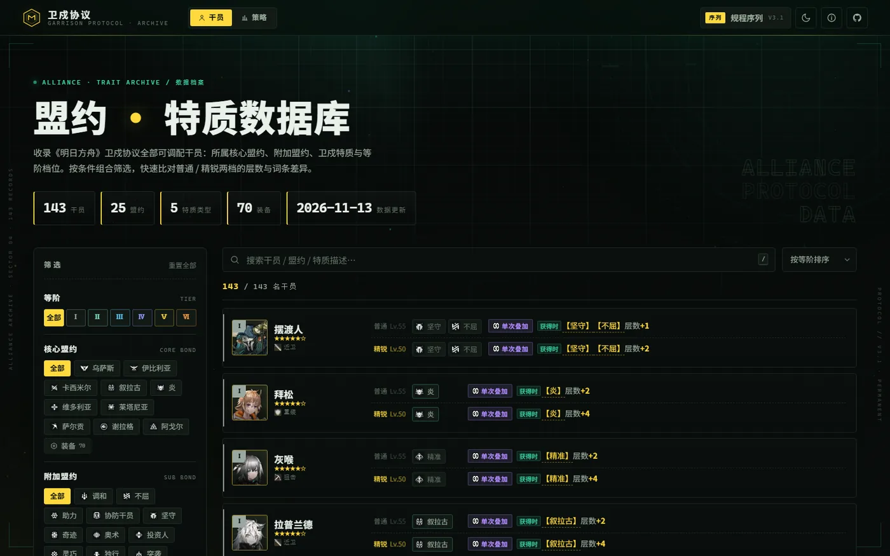
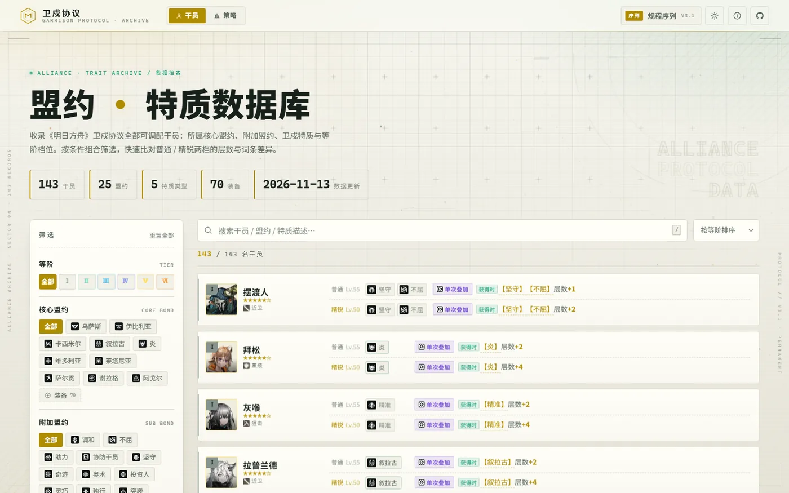

# 卫戍协议 · 盟约与特质数据库

> 《明日方舟》「卫戍协议 / Alliance」可调配干员的盟约、卫戍特质与等阶查询站。
> 纯静态站点，无后端、无运行时依赖，开箱即用，可直接部署到 GitHub Pages。



## ✨ 功能

- **单一数据源**：收录常驻协议「规程序列」V3.1 全部 143 名可调配干员。
- **四维筛选**：等阶（Ⅰ–Ⅵ）、核心盟约、附加盟约、特质词条（持续叠加 / 整备能力 / 作战能力 / 单次叠加 / 特异化）；同组多选为「或」，跨组为「且」。
- **普通 / 精锐对照**：每名干员同时展示普通与精锐两档的等级、盟约归属与特质描述，层数高亮。
- **即时搜索**：按干员名、盟约名、特质文本检索。
- **排序**：按等阶 / 稀有度 / 名称。
- **干员档案弹窗**：完整盟约说明、两档特质全文，可复制该干员的分享链接。
- **可分享状态**：筛选条件与搜索词全部同步到 URL `hash`；已选条件支持逐个点 `×` 移除。
- **动态背景**：漂移网格、雷达扫描、粒子数据流、扫描光束与 HUD 四角，均为轻量 Canvas / CSS 实现，并遵循 `prefers-reduced-motion`。
- **双主题视觉**：日间为工程蓝图风格（双层网格 / 十字刻度 / 斜切警示纹理 / 侧边技术标注 / 深色 HUD 角标），夜间为终端暗色；主题偏好写入 `localStorage`，首屏无闪烁。
- **响应式布局**（桌面侧栏 / 移动端抽屉）、键盘快捷键（`/` 搜索、`Esc` 关闭）。
- **零依赖**：原生 HTML + CSS + ES2020，无框架、无构建步骤。



## 🚀 使用

### 直接打开

双击 `index.html` 即可（数据已内联为 `data/seasons.js`，`file://` 协议下也能正常运行）。

### 本地预览（推荐）

```bash
python -m http.server 8080
# 或 npx serve .
```

打开 <http://localhost:8080>。

## 📦 部署到 GitHub Pages

```bash
git init
git add .
git commit -m "feat: 卫戍协议盟约与特质数据库"
git branch -M main
git remote add origin https://github.com/<你的用户名>/<仓库名>.git
git push -u origin main
```

然后在仓库 **Settings → Pages** 中选择 `main` 分支、`/ (root)`，保存后即可通过
`https://<你的用户名>.github.io/<仓库名>/` 访问。

> 仓库根目录已包含 `.nojekyll`，可避免 GitHub Pages 的 Jekyll 处理；所有资源均为相对路径，
> 部署在子路径（`/<仓库名>/`）下无需修改配置。

## 🗂 项目结构

```
.
├── index.html               # 单页入口
├── assets/
│   ├── css/main.css         # 全部样式（主题变量 / 布局 / 组件 / 动效 / 响应式）
│   ├── js/app.js            # 状态、筛选、排序、渲染、弹窗、URL 同步
│   ├── js/fx.js             # 背景粒子 / 扫描光效（Canvas）
│   └── img/
│       ├── ops/             # 干员头像（webp，160px）
│       ├── bonds/           # 盟约图标
│       ├── traits/          # 特质类型图标
│       ├── prof/            # 职业图标
│       └── favicon.svg
├── data/
│   ├── seasons.json         # 结构化数据（工具/二次开发用）
│   └── seasons.js           # 同一份数据的 JS 包装，供页面直接加载
├── scripts/build_data.py    # 数据构建脚本（抓取 → 解析 → 压缩图片）
└── docs/                    # README 预览图
```

## 🔄 更新数据

```bash
pip install pillow
python scripts/build_data.py             # 全量：抓取 + 生成 JSON + 下载图片
python scripts/build_data.py --no-images # 只重新生成 data/*.json 与 data/seasons.js
```

脚本会：

1. 从 `torappu.prts.wiki/gamedata/latest/excel/` 获取 `activity_table.json`（常驻协议数据）、
   `character_table.json`、`char_patch_table.json`；
2. 解析出「干员 → 等阶 / 盟约 / 普通·精锐特质」结构，输出 `data/seasons.json` 与 `data/seasons.js`；
3. 下载头像与图标到 `assets/img/`，头像统一转为 160px WebP。

> 目前仅构建常驻协议「规程序列」。如需恢复历史赛季（盟约 / 盟约·下半），
> 在 `scripts/build_data.py` 的 `SEASONS` 列表里追加 `archive:alliance_*.json` 条目即可。

原始数据缓存于 `_raw/`（已在 `.gitignore` 中忽略）。

### 数据结构（节选）

```jsonc
{
  "seasons": [{
    "id": "perm",
    "name": "规程序列",
    "bonds": [{ "id": "yanShip", "name": "炎", "type": "SEASON", "desc": "…" }],
    "traitTypes": [{ "key": "持续叠加", "icon": "s_icon_bond" }],
    "operators": [{
      "id": "char_492_quercu",
      "name": "夏栎",
      "rarity": 5,
      "profession": "辅助",
      "rank": 1,
      "tiers": [
        { "k": "normal", "label": "普通", "level": 55,
          "bonds": ["deputShip"],
          "traits": [{ "t": "持续叠加", "d": "<休整期结束时>使…层数<@ba.vup>+1</>" }] },
        { "k": "elite", "label": "精锐", "level": 50, "bonds": ["deputShip"], "traits": [] }
      ]
    }]
  }]
}
```

特质文本保留游戏内富文本标记，页面侧由 `app.js` 中的 `rich()` 解析为
条件标签、数值高亮与备注样式。

## 🎨 自定义

- 主题色 / 明暗变量：`assets/css/main.css` 顶部 `:root` 与 `[data-theme="light"]`。
- 名词与排序：`assets/js/app.js` 中的 `TRAIT_ORDER`、`HIDDEN_BONDS`。
- 添加赛季：编辑 `scripts/build_data.py` 的 `SEASONS` 列表后重新构建。

## 📜 数据来源与声明

- 游戏数据与图片素材来自 [PRTS.WIKI](https://prts.wiki)（玩家共同构筑的明日方舟中文 Wiki），
  原始接口：`torappu.prts.wiki`、`static.prts.wiki/app/spdatabase`、`media.prts.wiki`。
- 本站为**非官方**玩家工具，与上海鹰角网络科技有限公司无关；游戏内容版权归其所有。
- 仅供学习与查询使用，请勿用于商业用途。

## License

代码部分以 [MIT](LICENSE) 协议开源；游戏数据与美术素材版权归原权利方所有。
